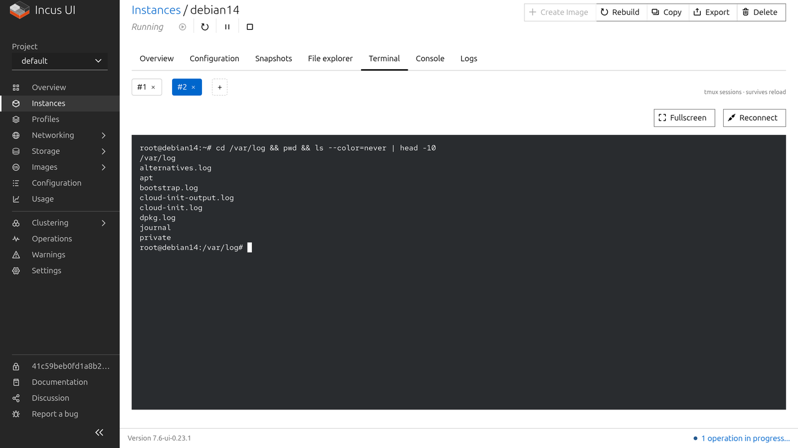

[English](README.md) · [简体中文](README.zh-Hans.md) · **Français**

# Incus UI (fork)

Une interface web pour [Incus](https://linuxcontainers.org/incus/). Elle simplifie la
gestion de conteneurs et de machines virtuelles, des petits aux grands clouds privés.

Ce dépôt est un fork de [zabbly/incus-ui-canonical](https://github.com/zabbly/incus-ui-canonical)
qui ajoute un **terminal multi-onglets avec sessions tmux persistantes** ainsi qu'une
**interface multilingue** — voir [Les ajouts de ce fork](#les-ajouts-de-ce-fork).

# Installation

L'interface n'est qu'un ensemble de fichiers statiques (`index.html` + `assets/`), servis
par incusd. Rien à installer en dehors d'Incus lui-même.

1. Rendre le serveur Incus accessible sur le réseau (8443 par défaut) :

       incus config set core.https_address :8443

2. Installer les fichiers et pointer incusd dessus :

       # archive de la release
       tar xzf incus-ui-multitab-*.tar.gz -C /opt/incus        # crée /opt/incus/ui

       # ou construire depuis les sources
       yarn install && yarn build && rsync -a build/ui/ /opt/incus/ui/

       install -d /etc/systemd/system/incus.service.d
       printf '[Service]\nEnvironment=INCUS_UI=/opt/incus/ui\n' \
         > /etc/systemd/system/incus.service.d/ui.conf
       systemctl daemon-reload && systemctl restart incus

3. Ouvrir `https://<hôte-incus>:8443/ui/` et accepter le certificat (ou se connecter via OIDC).

Les paquets des distributions fournissent déjà une interface au même chemin : la remplacer
suffit, aucune recompilation d'Incus n'est nécessaire.

# Les ajouts de ce fork

- **Terminal multi-onglets** — chaque onglet s'attache à une session tmux dans l'invité
  (`tmux new-session -A -s <sess>`) : les sessions survivent au rechargement de la page, à la
  fermeture d'un onglet et aux reconnexions. Les onglets sont mémorisés par instance ; si
  tmux est absent, l'interface propose un onglet d'installation en un clic et retombe sur un
  shell simple. `Alt+T` ouvre un onglet, `Alt+W` détache l'onglet actif, `Alt+1..9`
  changent d'onglet, et **Partager** permet à plusieurs navigateurs de s'attacher à la même
  session.

- **Traductions (i18n)** — basé sur i18next ; English, 简体中文 et Français sont fournis, avec
  un sélecteur de langue dans la barre latérale. Les langues sont découvertes dans
  `src/i18n/locales/` : **ajouter une langue = ajouter un fichier** :

  ```jsonc
  // src/i18n/locales/de.json
  { "_meta": { "label": "Deutsch", "dir": "ltr" }, "nav": { "instances": "Instanzen", ... } }
  ```

  Les clés manquantes retombent sur l'anglais, `_meta.dir: "rtl"` bascule `<html dir>` pour
  les langues droite-à-gauche, et les locales `zh-CN`/`fr-CA` sont rattachées au meilleur
  catalogue disponible.

- Version précompilée : <https://github.com/farfoodyou/incus-ui-canonical/releases>
- Correctif amont inclus : lecture des en-têtes `X-Incus-*`
  ([PR amont #266](https://github.com/zabbly/incus-ui-canonical/pull/266)).

Le multi-onglets et l'i18n restent propres à ce fork et ne sont pas proposés en amont.
Les conventions de développement (surface de hooks, synchronisation amont par merge) sont
décrites dans [FORK.md](FORK.md).

# Contribuer

- Lire le [guide de contribution](CONTRIBUTING.md) pour le processus de développement, la
  construction et les tests.
- [Voir les sources](https://github.com/canonical/lxd-ui) sur GitHub.

# Architecture

Application monopage écrite en TypeScript et React. Les détails de construction avec
[LXD](https://github.com/canonical/lxd) et d'environnement de développement sont dans
[Architecture](ARCHITECTURE.MD).

# Journal des modifications

Le [changelog](https://github.com/canonical/lxd-ui/releases) est mis à jour à chaque version.

# Feuille de route

Les projets et fonctionnalités prioritaires sont dans la [roadmap](ROADMAP.md).

# Exemples

| Créer une instance   | Liste des instances        |
|----------------------|----------------------|
|  |  |

|  Terminal d'instance   | Console graphique      |
|----------------------|----------------------|
|  |  |

| Pools de stockage         | Volume de stockage       |
|----------------------|----------------------|
|   |  |

| Réseau              | Réseau ACL          | 
|----------------------|----------------------|
|  |  |

| Créer un groupe       | Attribuer des permissions   |
|----------------------|----------------------|
|  |  |

| Groupes de permissions    | Opérations           |
|----------------------|----------------------|
|  |  |

| Profils             | Avertissements             |
|----------------------|----------------------|
|  |  |

| Groupes de cluster       | Paramètres du serveur      |
|----------------------|----------------------|
|  |  |
