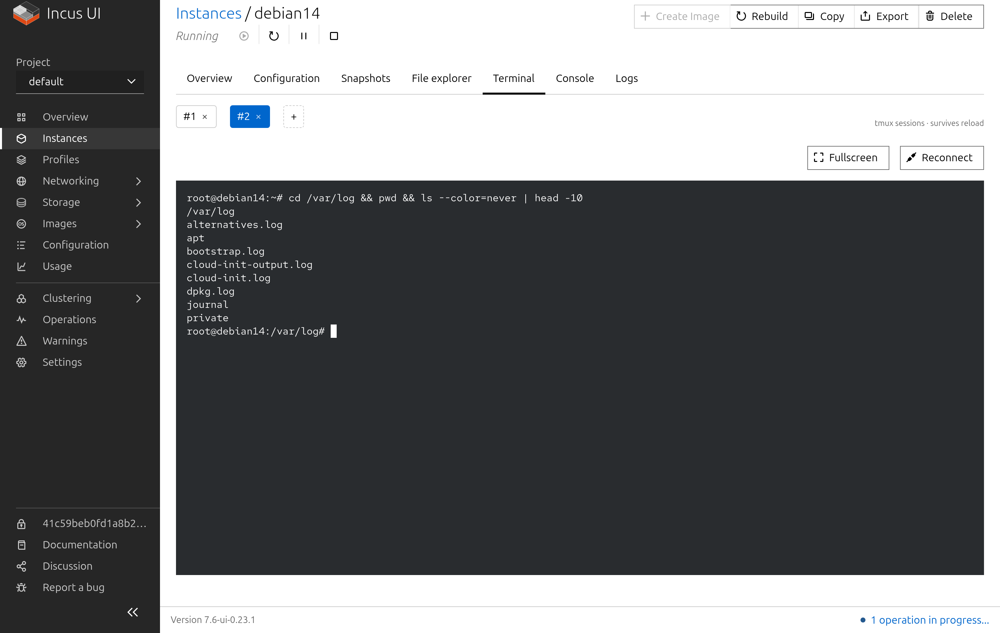

# Incus UI (fork)

A browser frontend for [Incus](https://linuxcontainers.org/incus/). It enables easy and
accessible container and virtual machine management, and targets small and large scale
private clouds.

This repository is a fork of [zabbly/incus-ui-canonical](https://github.com/zabbly/incus-ui-canonical)
that adds a **multi-tab terminal with persistent tmux sessions** — see [This fork](#this-fork).

# Install

The UI is plain static files (`index.html` + `assets/`), served by incusd. There is
nothing to install besides Incus itself and the files below.

1. Make sure the Incus server is reachable from the network (8443 is the default):

       incus config set core.https_address :8443

2. Put the UI files in place and point incusd at them:

       # released tarball
       tar xzf incus-ui-multitab-*.tar.gz -C /opt/incus        # gives /opt/incus/ui

       # or build from source
       yarn install && yarn build && rsync -a build/ui/ /opt/incus/ui/

       install -d /etc/systemd/system/incus.service.d
       printf '[Service]\nEnvironment=INCUS_UI=/opt/incus/ui\n' \
         > /etc/systemd/system/incus.service.d/ui.conf
       systemctl daemon-reload && systemctl restart incus

3. Open `https://<incus-host>:8443/ui/` and trust the browser certificate (or log in
   through OIDC) when prompted.

Distro packages ship their own copy of the UI at the same path; replacing it is enough,
no rebuild of Incus is needed.

# This fork

- **Multi-tab terminal** — every tab attaches to a tmux session in the guest
  (`tmux new-session -A -s <sess>`), so sessions survive page reloads, closed tabs and
  reconnects. Tabs are remembered per instance; when tmux is missing the UI offers a
  one-click install tab and falls back to a plain shell.

- Prebuilt release: <https://github.com/farfoodyou/incus-ui-canonical/releases>
- Upstream fix included: reading the `X-Incus-*` file metadata headers
  ([upstream PR #266](https://github.com/zabbly/incus-ui-canonical/pull/266)).

Multi-tab work is kept in this fork only; it is not proposed upstream.

# Contributing

You might want to:

- Read the [contributing guide](CONTRIBUTING.md), to learn about our development process and how to build and test your changes.
- [View the source](https://github.com/canonical/lxd-ui) on GitHub.

# Architecture

LXD-UI is a single page application written in TypeScript and React. See [Architecture](ARCHITECTURE.MD) for details on bundling with [LXD](https://github.com/canonical/lxd) and the dev setup.

# Changelog

The [changelog](https://github.com/canonical/lxd-ui/releases) is regularly updated to reflect what's changed in each new release.

# Roadmap
Future plans and high-priority features and enhancements can be found in the [roadmap](ROADMAP.md).

# Examples

| Create an instance   | Instance list        |
|----------------------|----------------------|
|  |  |

|  Instance terminal   | Graphic console      |
|----------------------|----------------------|
|  |  |

| Storage pools         | Storage volume       |
|----------------------|----------------------|
|   |  |

| Network              | Network ACL          | 
|----------------------|----------------------|
|  |  |

| Create a group       | Assign permissions   |
|----------------------|----------------------|
|  |  |

| Permission groups    | Operations           |
|----------------------|----------------------|
|  |  |

| Profiles             | Warnings             |
|----------------------|----------------------|
|  |  |

| Cluster groups       | Server settings      |
|----------------------|----------------------|
|  |  |
