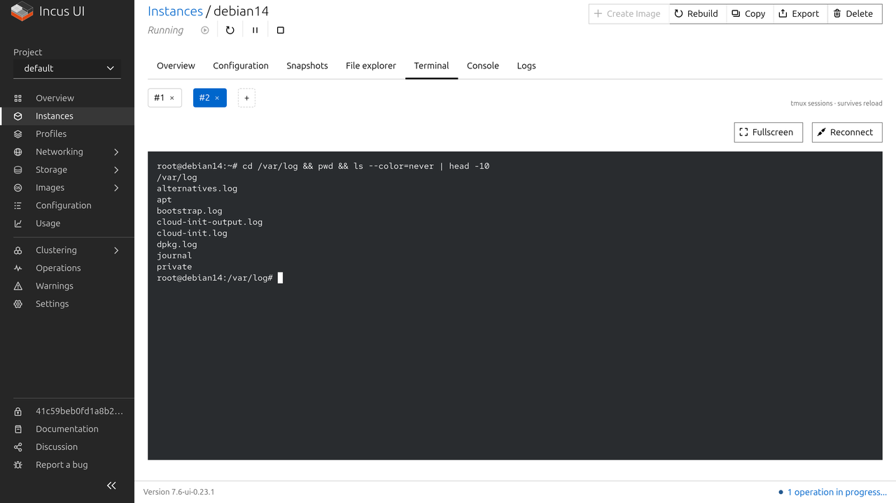

[English](README.md) · **简体中文** · [Français](README.fr.md)

# Incus UI（fork 分支）

[Incus](https://linuxcontainers.org/incus/) 的浏览器前端，可方便地管理容器与虚拟机，
适用于小规模到大规模私有云。

本仓库是 [zabbly/incus-ui-canonical](https://github.com/zabbly/incus-ui-canonical) 的 fork，
新增了**多标签终端（tmux 持久会话）**与**多语言界面** —— 详见 [本 fork 的改动](#本-fork-的改动)。

# 安装

UI 就是一组静态文件（`index.html` + `assets/`），由 incusd 托管。除 Incus 本身外不需要装别的东西。

1. 确认 Incus 服务可从网络访问（默认端口 8443）：

       incus config set core.https_address :8443

2. 放置 UI 文件并让 incusd 指向它：

       # 使用 Release 里的压缩包
       tar xzf incus-ui-multitab-*.tar.gz -C /opt/incus        # 解出 /opt/incus/ui

       # 或者自己构建
       yarn install && yarn build && rsync -a build/ui/ /opt/incus/ui/

       install -d /etc/systemd/system/incus.service.d
       printf '[Service]\nEnvironment=INCUS_UI=/opt/incus/ui\n' \
         > /etc/systemd/system/incus.service.d/ui.conf
       systemctl daemon-reload && systemctl restart incus

3. 浏览器打开 `https://<incus-host>:8443/ui/`，按提示信任证书（或通过 OIDC 登录）。

发行版自带的 UI 在同一个路径，直接替换即可，不需要重新编译 Incus。

# 本 fork 的改动

- **多标签终端** —— 每个标签在 guest 内 attach 一个 tmux 会话
  （`tmux new-session -A -s <sess>`），所以刷新页面、关闭标签、断线重连后会话都还在。
  标签按实例记忆；没有 tmux 时 UI 会提供一个一键安装标签，并降级为普通 shell。

- **多语言（i18n）** —— 基于 i18next，内置 English、简体中文、Français，
  侧边栏有语言切换器。语言由 `src/i18n/locales/` 目录自动发现，**新增语言只需加一个文件**：

  ```jsonc
  // src/i18n/locales/de.json
  { "_meta": { "label": "Deutsch", "dir": "ltr" }, "nav": { "instances": "Instanzen", ... } }
  ```

  缺失的键回退到英文；`_meta.dir: "rtl"` 会把 `<html dir>` 切成从右到左；
  浏览器语言 `zh-CN`/`fr-CA` 会自动匹配到最合适的语言包。

- 预编译版本：<https://github.com/farfoodyou/incus-ui-canonical/releases>
- 已包含上游修复：读取 `X-Incus-*` 文件元数据响应头
  （[上游 PR #266](https://github.com/zabbly/incus-ui-canonical/pull/266)）。

多标签与 i18n 只保留在本 fork，不向上游提 PR。

# 参与贡献

- 阅读[贡献指南](CONTRIBUTING.md)，了解开发流程与构建/测试方式。
- 在 GitHub 上[查看源码](https://github.com/canonical/lxd-ui)。

# 架构

本项目是用 TypeScript 与 React 编写的单页应用，构建与开发环境的细节见 [Architecture](ARCHITECTURE.MD)。

# 变更记录

[更新日志](https://github.com/canonical/lxd-ui/releases) 会随每个版本更新。

# 路线图

后续计划与高优先级特性见 [roadmap](ROADMAP.md)。

# 界面示例

| 创建实例   | 实例列表        |
|----------------------|----------------------|
|  |  |

|  实例终端   | 图形控制台      |
|----------------------|----------------------|
|  |  |

| 存储池         | 存储卷       |
|----------------------|----------------------|
|   |  |

| 网络              | 网络 ACL          | 
|----------------------|----------------------|
|  |  |

| 创建用户组       | 分配权限   |
|----------------------|----------------------|
|  |  |

| 权限组    | 操作           |
|----------------------|----------------------|
|  |  |

| 配置档案             | 警告             |
|----------------------|----------------------|
|  |  |

| 集群组       | 服务器设置      |
|----------------------|----------------------|
|  |  |
